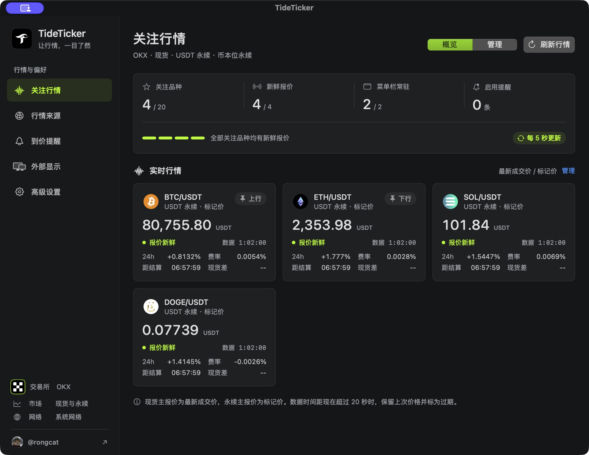

  

<h1 align="center">TideTicker</h1>

  <strong>让行情，一目了然。</strong> 
  原生 macOS 菜单栏加密货币行情观察工具

  
  
  
  

  <a href="https://github.com/realRongCat/TideTicker/releases/latest"><strong>下载最新版</strong></a>
  · <a href="./docs/USER_GUIDE.md">使用指南</a>
  · <a href="./CHANGELOG.md">更新记录</a>

## ✨ 功能

| | |
| --- | --- |
| **菜单栏常驻** 最多两条，始终保持图标、币种和价格 | **多市场观察** OKX、Binance、Bybit，最多关注 20 个品种 |
| **清晰报价口径** 现货看最新成交价，永续看标记价 | **永续风险快照** 资金费率、结算倒计时和同所现货溢折价 |
| **本地到价提醒** 支持确认后重新布防，并明确提示可能漏报 | **版本感知** 自动发现 GitHub 稳定版 Release |

## 📦 安装

macOS 13 或以上，从 [GitHub Releases](https://github.com/realRongCat/TideTicker/releases/latest) 下载 Universal DMG。

> **交给 Agent：** 从 `realRongCat/TideTicker` 的最新 GitHub Release 下载 Universal DMG 和对应的 `.sha256`，校验后安装并启动 `TideTicker.app`；若 Gatekeeper 拦截，请停下并提示我在 macOS“隐私与安全性”中确认。

> [!NOTE]
> 当前安装包使用 ad-hoc 签名，尚未经过 Apple 公证；Intel 架构已完成编译验证，Intel 真机运行仍待验证。

[查看完整安装、首次启动与源码构建说明 →](./docs/USER_GUIDE.md#安装)

## 🚀 三步开始

| 1. 打开 | 2. 配置 | 3. 提醒 |
| --- | --- | --- |
| 点击菜单栏报价，进入主窗口 | 选择交易所、关注品种和两条常驻位置 | 创建本地规则，并允许系统通知 |

全新配置默认使用 OKX 和系统网络，常驻 BTC、ETH 的 USDT 永续标记价。补充行情默认关闭，开启后只扩展行情卡，不改变菜单栏布局。

## 🧭 行情口径

| 市场 | 主报价 | 结算 |
| --- | --- | --- |
| USDT 现货 | 最新成交价 | USDT |
| USDT 线性永续 | 标记价 | USDT |
| USD 币本位永续 | 标记价 | 标的币 |

> [!CAUTION]
> TideTicker 只辅助观察。网络、休眠、交易所异常和本机延迟都可能造成漏报，不能替代交易所风控或止损。

## 🔒 数据与隐私

无需交易账户或 API Key，不提供交易和下单能力。关注列表、提醒和偏好只保存在本机；应用仅访问交易所公共行情接口和 GitHub Release API。详见 [使用指南](./docs/USER_GUIDE.md) 与 [隐私说明](./PRIVACY.md)。

## 📚 项目文档

| 读者 | 入口 |
| --- | --- |
| 使用者 | [完整使用指南](./docs/USER_GUIDE.md) · [更新记录](./CHANGELOG.md) |
| 贡献者 | [构建与贡献](./CONTRIBUTING.md) · [发布清单](./docs/RELEASE_CHECKLIST.md) |
| 维护者 | [领域语义](./CONTEXT.md) · [现役设计](./DESIGN.md) · [架构决策](./docs/adr) |
| Coding Agent | [AGENTS.md](./AGENTS.md) |

## ⭐ Star History

  <a href="https://www.star-history.com/#realRongCat/TideTicker&Date">
    <picture>
      <source media="(prefers-color-scheme: dark)" srcset="https://api.star-history.com/svg?repos=realRongCat/TideTicker&type=Date&theme=dark">
      <source media="(prefers-color-scheme: light)" srcset="https://api.star-history.com/svg?repos=realRongCat/TideTicker&type=Date">
      
    </picture>
  </a>

  使用 <a href="./LICENSE">MIT License</a> 开源 · Made by <a href="https://x.com/rongcat">@rongcat</a>

